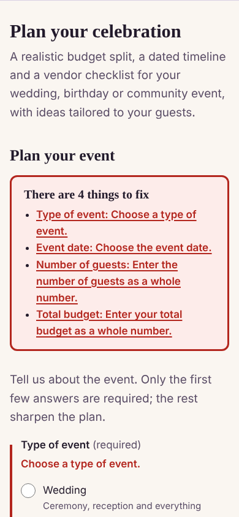
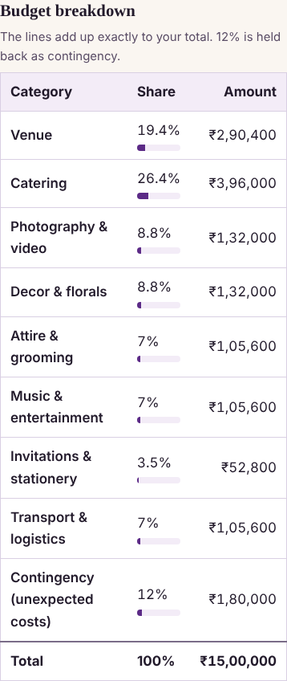
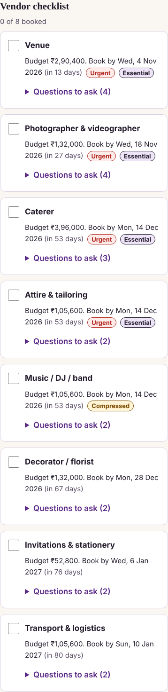
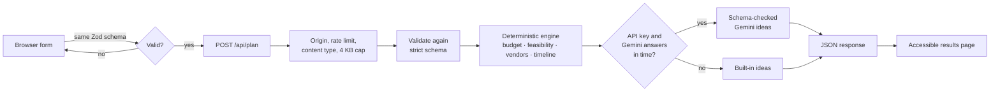

# Celebration & Event Planner

A planning assistant for **weddings, birthdays and community events**. Tell it the date, guest count,
budget and what matters to you, and it returns a realistic budget split, a dated timeline, a vendor
checklist with the questions worth asking, and personalised ideas.

Built for **Google PromptWars, Challenge 5: Celebration & Event Planner** (Next.js 16, React 19,
TypeScript, Gemini).

|                    Validation                    |                   Budget                    |                 Vendor checklist                 |
| :----------------------------------------------: | :-----------------------------------------: | :----------------------------------------------: |
|  |  |  |

---

## 1. Chosen vertical

**Challenge 5: Celebration & Event Planner.** _"Create a GenAI-powered planning assistant that
helps users organize weddings, birthdays, and community events with budgets, timelines, vendor
checklists, and personalized ideas."_

| Requirement in the brief              | Where it lives                                                                 |
| ------------------------------------- | ------------------------------------------------------------------------------ |
| Weddings, birthdays, community events | One data blueprint per event type (`src/lib/planner/blueprints.ts`)            |
| Budgets                               | Exact budget split with contingency and a feasibility verdict                  |
| Timelines                             | Dated task list that adapts when the event is closer than a typical plan       |
| Vendor checklists                     | Per-vendor budget, book-by date, essential flag and questions to ask           |
| Personalised ideas                    | Gemini, constrained to a schema, with a built-in fallback                      |
| Smart, dynamic decisions              | Every output changes with the person's context (see the decision tables below) |

---

## 2. Approach and logic

### The key decision: a hybrid, not "ask the model for a plan"

A language model is good at _creative, personalised wording_ and unreliable at _arithmetic and
dates_. A budget that does not add up, or a "book the venue" task dated in the past, is a worse
failure than a bland suggestion. So the work is split by what each part is good at:

| Part                                         | Done by                     | Why                                                         |
| -------------------------------------------- | --------------------------- | ----------------------------------------------------------- |
| Budget split, feasibility, timeline, vendors | **Deterministic code**      | Exact, explainable, testable, instant, works offline        |
| Theme, menu, activity, decor, saving ideas   | **Gemini** (schema-bound)   | Creative and personal; wrong output is harmless and checked |
| Ideas when Gemini is unavailable             | **Built-in rule-based set** | The product never breaks because an API did                 |

The response always says which wrote the ideas (`ideasSource: "gemini" | "fallback"`), and the page
tells the person.

### How the planner decides

**Budget split.** Each event type has a weighted list of categories (a wedding, for example: venue 22%,
catering 30%, photography 10%, decor 10%, attire 8%, entertainment 8%, stationery 4%, transport 8%).

1. Categories the host marked as priorities get their weight multiplied by 1.25.
2. A contingency is reserved first: **10%**, or **12% when the event is outdoors** (weather and
   logistics surprises).
3. The remainder is shared out by weight using the **largest-remainder method**, so every line is a
   whole number and the lines **always sum to exactly the budget**. (Rounding each line separately
   routinely loses or invents a rupee; this cannot.)

**Feasibility.** The budget is divided by the guest count and compared with two reference points per
currency and event type (for a wedding in INR: **₹1,500** per guest is the lean minimum and **₹3,500**
is comfortable).

| Per guest             | Verdict         | What the person is told                                                            |
| --------------------- | --------------- | ---------------------------------------------------------------------------------- |
| ≥ comfortable         | **Comfortable** | Keep the contingency untouched                                                     |
| ≥ lean, < comfortable | **Tight**       | Workable; the guest count or budget that would be comfortable; where to trim first |
| < lean                | **At risk**     | A simpler format; the numbers that would fix it; where to trim first               |

"Where to trim first" names the largest _discretionary_ lines the host did **not** prioritise, so the
advice never contradicts their stated priorities.

**Timeline and vendors.** Each task and vendor has a standard lead time (for example "book the venue
270 days ahead"). The plan horizon is the longest lead time (wedding 270 days, birthday 45,
community event 60).

| Situation                               | What happens                                                                                       |
| --------------------------------------- | -------------------------------------------------------------------------------------------------- |
| Event is further away than the horizon  | Standard lead times are used as they are                                                           |
| Event is closer than the horizon        | **Every** lead time is scaled by the same factor, so task order is preserved, and the plan says so |
| A lead time cannot fit in the days left | Flagged **Urgent** if the task is critical (venue, caterer), **Compressed** if not                 |
| Event day and follow-ups                | Exact offsets, never scaled                                                                        |

Nothing is ever dated before today, and the vendor checklist and the "Book: …" timeline tasks are
generated from the same source, so they cannot disagree.

**Context changes the checklist.** Dietary needs (vegetarian, vegan, halal, Jain, gluten-free, nut
allergy), access needs (step-free, seating for elders, child-friendly, hearing support) and an outdoor
venue each add specific questions to the right vendor, for example _"Can you prepare Jain dishes
without root vegetables, onion or garlic, using separate utensils?"_ for the caterer, or _"What is the
weather backup and who decides on the day?"_ for an outdoor venue. The priorities offered also depend
on the event type (a community event has no photographer to prioritise).

**Personalised ideas.** The model receives structured facts (event type, guest count, setting, days
left, feasibility, priorities, needs, how the budget is split) plus two cleaned free-text fields (city
and style). It is asked for JSON matching a strict schema; the response is parsed and validated again
before it is shown, and anything wrong falls back to the built-in set.

---

## 3. How it works



1. The browser validates with the **same schema** the server uses, so feedback is instant and the two
   can never disagree. Errors appear in a focused summary above the form and beside each field.
2. `POST /api/plan` runs the cheapest checks first: cross-site rejection, rate limit, content type,
   body size (4 KB, enforced on the streamed bytes), JSON parse, strict schema.
3. `buildPlan` (a pure function) produces the plan. It reads no clock and does no I/O: the current
   time is passed in.
4. The ideas service asks Gemini for schema-constrained JSON with a hard timeout. On any failure
   (no key, timeout, refusal, truncation, bad JSON, schema violation) it returns the built-in ideas.
5. The page renders the plan with real headings, a real table, and a checklist.

### Project structure

```
src/
  app/                  Next.js pages, API route, global styles, error and 404 pages
  proxy.ts              Per-request nonce and Content-Security-Policy
  components/           Form, results and small accessible building blocks
  lib/
    domain/             Types and limits shared by every layer (no framework imports)
    planner/            The deterministic engine: blueprints, budget, feasibility,
                        schedule, timeline, vendors, buildPlan
    validation/         The one request schema, used by browser and server
    ai/                 Gemini client, prompt, output schema, ideas service, fallback
    security/           Sanitiser, rate limiter, client IP, security headers
    http/               Body reader with size cap, API errors, JSON responses
    server/             Config, logger, request handler, dependency container
    client/             Browser-side API call and form-to-payload mapping
tests/
  unit/                 Engine, validation, security, API, config, stylesheet contrast
  ui/                   Components and pages, with automated axe accessibility checks
```

Dependencies point inward: the engine knows nothing about HTTP, React or Gemini; the handler receives
its collaborators (rate limiter, ideas service, logger, clock) as arguments, so every branch is
testable with fakes and no network.

---

## 4. Security

The application stores nothing (no accounts, database or cookies), and the only user input is a short
form. The controls below still treat every request as hostile.

| Risk (OWASP)                       | Control                                                                                                                                                                                                                                                                                                  | Evidence                                        |
| ---------------------------------- | -------------------------------------------------------------------------------------------------------------------------------------------------------------------------------------------------------------------------------------------------------------------------------------------------------- | ----------------------------------------------- |
| **A03 Injection / XSS**            | React escapes output; no `dangerouslySetInnerHTML`, `innerHTML` or `eval` anywhere in `src`; nonce-based CSP with no `unsafe-inline` for scripts in production                                                                                                                                           | `proxy.ts`, `headers.test.ts`, `proxy.test.ts`  |
| **A03 Injection (input)**          | One strict Zod schema; unknown fields rejected; whole numbers, real calendar dates, enumerated choices, city allow-list pattern, length limits                                                                                                                                                           | `planRequest.ts`, `validation.test.ts`          |
| **A04 Insecure design**            | Hybrid design: the model never touches money or dates, so a manipulated model cannot change a number a person acts on                                                                                                                                                                                    | `buildPlan.ts`, `ideasService.ts`               |
| **A05 Misconfiguration**           | Full header set (CSP, HSTS, `nosniff`, frame denial, referrer and permissions policy, COOP/CORP); framework banner removed; environment validated at first use                                                                                                                                           | `next.config.ts`, `config.ts`, `config.test.ts` |
| **A01 Broken access / CSRF**       | `Sec-Fetch-Site: cross-site` refused; JSON-only content type (forces a CORS preflight); no ambient credentials exist to abuse                                                                                                                                                                            | `planHandler.ts`, `planHandler.test.ts`         |
| **A02 Secrets**                    | API key read from the server environment only; never sent to the browser or logged; `.env*` ignored by git; config errors name the setting, never the value                                                                                                                                              | `config.ts`, `container.ts`, `route.test.ts`    |
| **A06 Vulnerable components**      | Exact-pinned dependencies, lockfile and `npm ci`; `npm audit` reports 0 vulnerabilities and runs in CI                                                                                                                                                                                                   | `package.json`, `.github/workflows/ci.yml`      |
| **A09 Logging**                    | Structured logs whose fields can only be primitives, so bodies, prompts and error objects cannot be logged by accident; error text is never logged                                                                                                                                                       | `logger.ts`, `responses.ts`, `ideas.test.ts`    |
| **A10 SSRF**                       | The server never fetches a user-supplied URL; the model name is restricted by a pattern                                                                                                                                                                                                                  | `config.ts`                                     |
| **Resource abuse**                 | 4 KB body cap on streamed bytes; per-client sliding-window rate limiter with a bounded key table; client IP accepted only if `net.isIP` agrees                                                                                                                                                           | `body.ts`, `rateLimit.ts`, `clientIp.ts`        |
| **LLM01 Prompt injection**         | Layered: input sanitised (NFKC first, so look-alike brackets are normalised, then delimiters, control and bidi characters removed); data placed in a delimited JSON block; system rule that the block is data; schema-constrained output; output validated again; the model has no tools, money or dates | `sanitize.ts`, `prompt.ts`, `ideas.test.ts`     |
| **LLM02 Insecure output handling** | Model output is parsed, sanitised and strictly schema-validated before it is shown, and then rendered as text (never as HTML)                                                                                                                                                                            | `ideasSchema.ts`                                |
| **LLM10 Unbounded consumption**    | One model call per request, `maxOutputTokens` cap, hard timeout, SDK retries disabled (its default of 5 would multiply cost during an outage), rate limited                                                                                                                                              | `geminiClient.ts`, `ideasService.ts`            |
| **Information disclosure**         | Every unexpected failure becomes the same generic 500; validation errors never echo input                                                                                                                                                                                                                | `planHandler.test.ts`                           |

Reporting a vulnerability: see [SECURITY.md](SECURITY.md).

---

## 5. Efficiency

- **No work that does not need doing.** The engine is a handful of small table lookups and a sort:
  microseconds, no I/O. Currency formatters are cached.
- **At most one outbound call per request**, with a bounded output size, a timeout (default 12 s) and
  no retries, so the worst case is fast and cheap rather than slow and expensive.
- **Graceful degradation is also a speed feature:** with no key the response is immediate, and when
  Gemini is slow the wait is capped by the timeout instead of hanging.
- **Small client.** The stylesheet is under 3 KB gzipped and there are no UI or date libraries; the
  JavaScript is React, Next.js and about a dozen small components. Whole-site client JavaScript
  measured at about 215 KB gzipped in the production build, almost all of it the framework runtime.
- **Bounded memory.** The rate limiter keeps at most `max` timestamps per client and evicts the
  oldest clients beyond 10,000.
- **Lazy wiring.** Dependencies are created on first request, so `next build` needs no secrets and
  cold start does no network work.

---

## 6. Accessibility

Designed to **WCAG 2.2 AA**:

- Landmarks (banner, main, contentinfo), a skip link, one `h1`, and a heading outline with no skipped
  levels; the language is declared.
- Every control has a visible label; hints and errors are tied to the control with `aria-describedby`;
  invalid fields carry `aria-invalid`, and error text starts with a visually hidden "Error:" so it is
  not conveyed by colour or position alone.
- Validation uses `noValidate` plus our own messages: an **error summary** receives focus on failure,
  and each entry links to (and focuses) its field.
- Groups of radios and checkboxes use `<fieldset>` and `<legend>`.
- The results are a real `<table>` (caption, column and row headers), ordered lists, `<time>`
  elements, and `<details>` for vendor questions. Status uses **words** ("Urgent", "Compressed",
  "Critical") as well as colour. The share bars are decorative and hidden from assistive technology,
  because the percentage beside each is the information.
- Targets are at least 44 px; one high-contrast focus ring is used everywhere; text sizes use `rem`
  and zoom is never disabled; the layout reflows at phone width.
- Light and dark themes (`prefers-color-scheme`), `prefers-reduced-motion`, `forced-colors`
  (Windows high contrast) and print styles are supported.
- Focus moves to the error summary on failure and to the plan heading on success.

**How this is checked:** `axe-core` runs inside the test suite on the form, the error state, the
results for every event type (relaxed and urgent), and the error and 404 pages. Colour contrast,
which a simulated DOM cannot compute, is checked by `tests/unit/contrast.test.ts`, which parses the
real stylesheet tokens and verifies every text and control-boundary pair in both themes against WCAG
ratios. ESLint's `jsx-a11y` strict rules run on every change.

**What this is not:** automated checks catch only a portion of accessibility problems. The interface
has not been tested with people who use screen readers or other assistive technology, and it should
be before it is relied on.

---

## 7. Testing

```bash
npm test                # all tests
npm run test:coverage   # with coverage and enforced thresholds
npm run check           # type-check + lint + formatting + tests
```

**481 tests in 27 files**, about 99.7% statement and 94.9% branch coverage (CI fails if coverage falls
below the thresholds in `vitest.config.mts`). They are written to check behaviour, not to execute lines:

- **Properties, not just examples.** The budget lines sum exactly to the total over 3,000 random
  cases and every event type, currency and awkward amount; schedule order is preserved across
  event distances from 1 to 400 days; every combination of event type, setting and budget level,
  with and without dietary and access needs, produces fallback ideas that satisfy the same schema
  as model output.
- **Boundaries.** Feasibility thresholds for every currency and event type at exactly the
  limit and one unit either side; leap days and impossible dates; body size at the limit and one
  byte over; rate-limit window edges with an injected clock.
- **Every API outcome.** 200, 400, 403, 413, 415, 422, 429 and 500 paths, plus checks that internals
  (messages, keys, setting values) never reach the client or the logs.
- **The Gemini boundary** is tested with the SDK mocked: request shape, schema, token cap, single
  attempt, truncated and empty responses, malformed JSON, schema violations and timeouts all fall
  back safely.
- **The interface** is tested the way people use it: keyboard, focus movement, error links, double
  submission, pending state, every failure message, and axe on each state.

Writing these tests found and fixed two real defects: a date helper that silently rolled 30 February
over to 2 March, and a deployment misconfiguration that returned a 500 without writing anything to
the logs.

**Not covered:** the live Gemini API. See _Assumptions and limitations_.

---

## 8. Assumptions and limitations

1. **Numbers are planning heuristics, not quotes.** Category weights, the 1.25 priority boost, the
   10 and 12% contingency, the per-guest lean and comfortable reference points, and every lead time
   are illustrative and live as plain data in `blueprints.ts`, where they are easy to tune to a
   market. Prices vary widely by city and season; the page tells people to confirm with vendors.
2. **Dates are UTC calendar dates.** "Today" is the server's UTC date. A person in a far-east time zone
   late in their evening may see "today" one day behind. An event must be 1 to 1,095 days away.
3. **Scope.** Three event types, four currencies (INR, USD, EUR, GBP), English only, guests 1 to
   5,000. INR is the default because the project was built in India; it is a dropdown.
4. **Nothing is saved.** There are no accounts. The vendor "booked" ticks live in the page and are
   lost on refresh (this is deliberate: nothing about a person's event is stored).
5. **Gemini is optional.** Without `GEMINI_API_KEY` the whole product works and the ideas come from
   the built-in set. The default model is `gemini-3.8-flash`, which Google documents as stable with
   structured-output support; change it with `GEMINI_MODEL`.
6. **The live Gemini call has not been exercised in the development environment (no key was
   available).** It is covered by tests with the SDK mocked, and any failure degrades to the built-in
   ideas, so the worst outcome is the fallback. After deploying with a key, submit one plan: the ideas
   section should read "Written for you by Gemini". If it says "Built-in suggestions", the server log
   contains an `ideas.fallback` line with the reason (`timeout`, `invalid_json`, `schema_mismatch`,
   `upstream_error` and so on).
7. **Rate limiting is per server instance** (in memory). On a multi-instance or serverless
   deployment, add a platform-level limit (edge, WAF or a shared store) in front; this one is a safety
   net. The client address comes from `x-real-ip` / `x-forwarded-for`, which a platform such as
   Vercel sets and overwrites; behind an unknown proxy those headers can be spoofed.
8. **Suggestions are not professional advice.** Vendor questions are generic good practice, and
   nothing here is legal, financial or medical advice (including dietary and accessibility notes,
   which are prompts to ask, not guarantees).
9. **Free text is deliberately limited** to a city and a 280-character style note, both cleaned
   before use. There is no open chat, so there is nothing for a person to "jailbreak" beyond those
   two short fields.

---

## 9. Run it

Requires **Node.js 22+**.

```bash
npm ci
cp .env.example .env.local     # optional: add GEMINI_API_KEY
npm run dev                    # http://localhost:3000
```

| Variable               | Default            | Purpose                                                      |
| ---------------------- | ------------------ | ------------------------------------------------------------ |
| `GEMINI_API_KEY`       | _(none)_           | Enables Gemini-written ideas. Create one at Google AI Studio |
| `GEMINI_MODEL`         | `gemini-3.8-flash` | Model for the ideas call (must look like `gemini-…`)         |
| `GEMINI_TIMEOUT_MS`    | `12000`            | Hard limit on the Gemini call (1,000 to 30,000)              |
| `RATE_LIMIT_MAX`       | `10`               | Requests per client per window                               |
| `RATE_LIMIT_WINDOW_MS` | `60000`            | Window length                                                |

Production: `npm run build && npm start`, or deploy to any Node host (for example Vercel or Cloud
Run) with `GEMINI_API_KEY` set as a secret environment variable. The build needs no secrets.

| Script                  | Does                                |
| ----------------------- | ----------------------------------- |
| `npm run typecheck`     | TypeScript strict, no emit          |
| `npm run lint`          | ESLint (strict type-checked + a11y) |
| `npm run format:check`  | Prettier                            |
| `npm test`              | Unit and UI tests                   |
| `npm run test:coverage` | Tests with enforced coverage floors |
| `npm run build`         | Production build                    |

---

## 10. How this maps to the evaluation criteria

| Criterion (weight)                     | What to look at                                                                                                                                                                                                                                                                                                                               |
| -------------------------------------- | --------------------------------------------------------------------------------------------------------------------------------------------------------------------------------------------------------------------------------------------------------------------------------------------------------------------------------------------- |
| **Problem statement alignment** (high) | All five parts of the brief, for all three event types; decisions driven by the person's context (priorities, outdoor, dietary and access needs, time remaining, budget per guest); practical honesty about what is estimated. Section 2.                                                                                                     |
| **Code quality** (high)                | Layered architecture with inward-pointing dependencies; pure, injectable core; planning knowledge as data, so budget, vendors and timeline cannot drift apart; one validation schema shared by client and server; TypeScript `strict` with `noUncheckedIndexedAccess`; ESLint strict type-checked with zero warnings; comments explain _why_. |
| **Security** (high)                    | Section 4: layered controls mapped to OWASP and OWASP-LLM, each with a test.                                                                                                                                                                                                                                                                  |
| **Efficiency** (medium)                | Section 5: no wasted work, one bounded model call, graceful degradation, bounded memory, small client.                                                                                                                                                                                                                                        |
| **Testing** (low)                      | Section 7: 481 tests, property-based and boundary tests, every API outcome, enforced coverage floors, CI.                                                                                                                                                                                                                                     |
| **Accessibility** (low)                | Section 6: WCAG 2.2 AA by design, axe in the suite, contrast verified from the stylesheet, honest limits.                                                                                                                                                                                                                                     |

---

## Licence

[MIT](LICENSE).
